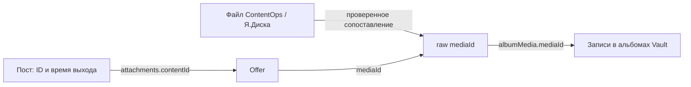

# Откуда брать сведения о файлах и публикациях: проверка Hub / Fansly

Проверено 03.09.2026. Это результаты исследования и предложения к интеграции;
реализация в Hub и ContentOps в рамках этой проверки не выполнялась.

## Вывод и рекомендуемый путь

**Нужные данные у Fansly есть. Текущего агентского API Hub недостаточно, чтобы
уверенно связать файл из библиотеки с публикацией.** Разрыв находится в трёх местах:

1. У файла ContentOps / Я.Диска ещё нет проверенной связи с платформенным `mediaId`.
2. Hub сохраняет часть связей и метаданных, но не все их обрабатывает и выдаёт агенту.
3. Неполный обход и задержка наблюдения не позволяют превращать отсутствие результата
   в утверждение «этого файла здесь никогда не было».

Практический выбор: **дополнить существующий сбор и API Hub**, затем сопоставить старую
библиотеку по совокупности признаков с разбором неоднозначностей. Для будущих загрузок
лучше отдельно фиксировать квитанцию `ассет → загруженные байты → mediaId`, пока эта
связь известна. Browser Network пригоден для исследования и проверки сборщика.
Постоянный сборщик Fansly в ContentOps не нужен.

## Что действительно проверено

- Рабочий агентский CLI `hub` против `https://gosling-agency.ru`: capabilities,
  `posts`, `vault_media`, `capture_coverage`; дополнительные пробы OnlyFans и stories.
- Авторизованная страница **lora-1 / LoraVie** в Firefox: Vault, полный небольшой
  альбом, штатные JSON-ответы Network, один конкретный пост.
- Исходники Hub на ревизии `e99dda97a8659111fda7fa474c1a2bb087727de2`.
  Метка работающего production image указывает `e99dda97a865` — код соответствует
  развёрнутой ревизии. Контракт API:
  `708e3923f1411da77a62cd9932f20b65995268ac0e1d40423217ef120473db5f`.
- Настоящий обработчик Hub запущен локально на сохранённых ответах Firefox,
  без обращения к production БД и без записи событий.
- Снимок Я.Диска от **02.09.2026 12:40 МСК**: 10 970 файлов; ранее измеренный через
  ffprobe Windows-корпус: 3 853 видео. По нормализованному пути и точному размеру
  удалось связать со снимком 2 955 измеренных видео.

[Числа, ID и результаты проб](hub-media-discovery/evidence.json) сохранены отдельно.
[Скрипт пересчёта кандидатов](hub-media-discovery/reproduce.py) работает только с
локальными экспортами. В репозитории нет токенов, заголовков запросов, CDN-ссылок,
байтов медиа, подписей постов и частных названий файлов.

Ограничения доступа: owner-интерфейс Hub в Chrome потребовал вход; его более богатый
API проверен по коду, без живого запроса с owner-сессией. Прямой SQL не использовался:
на production не оказалось разрешённой роли `read_only`. Сведения о содержимом
конкретных production raw-payloads поэтому не подтверждены прямым чтением БД.

## 1. Что отдаёт агентский API Hub сейчас

| Набор | Доступные данные | Чего не хватает для этой задачи |
|---|---|---|
| `posts` | `postRef`, точный `postText`, `publishedAt`, `attachmentCount`, `firstObservedAt`, `lastObservedAt` | ID вложений, связь offer → файл, роль preview, поверхность/стены/FYP |
| `vault_media` | `vaultKind`, `albumRef`, `mediaRef`, `memberRef`, тип, платформенная дата членства, времена наблюдения; offer/bundle могут быть `null` | Название альбома, имя файла, подпись элемента Vault, длительность и размеры исходника |
| `capture_coverage` | Состояние обхода по потоку и scope, ожидаемый счётчик, причина остановки | Завершённость большого Vault сейчас ещё не достигнута |
| `stories` | В capabilities: `planned`, `captured_unparsed`, без полей | Рабочая типизированная выдача; CLI не принимает этот dataset |

`vault_media` заявлен только для Fansly. Проба на `lora-of` вернула ноль строк,
но это **не доказательство пустого OnlyFans Vault**. Наличие сырого архива stories
отдельно не проверялось; состояние capabilities не доказывает полноту сбора.

В коде owner-API есть `GET /api/v1/pages/:pageLabel/content/media`: более подробные
данные медиа и альбомов. Использовать owner-cookie как рабочую интеграцию не следует;
нужные поля должны войти в контракт агентского API с обычными grants. [Обработчик owner-API][owner-media]

Источники: [поля posts и других datasets][dataset-map], [контракт capabilities][capabilities],
[выдача и семантика курсора][dataset-handler].

## 2. Какие данные лежат в штатном Network Fansly

### Альбомы

`GET https://apiv3.fansly.com/api/v1/vault/albumsnew?ngsw-bypass=true`

В ответе есть `response.albums[]`: ID, название, тип, счётчики, временные поля;
рядом — `aggregationData.media[]` с метаданными некоторых обложек.

На lora-1 увидели **27 альбомов**. Счётчики системных альбомов: All — 7 800,
Posts — 4 846, Messages — 3 294. Их нельзя складывать: один файл входит в несколько
альбомов. Это счётчики провайдера, а не результат полного собственного пересчёта.

### Содержимое альбома

```text
GET /api/v1/media/vaultnew
    ?albumId=766719929742274567
    &mediaType=&search=&before=0&after=0&ngsw-bypass=true
```

Ответ разделяет **запись в альбоме** и **сам файл**:

| Часть ответа | Поля, полезные ContentOps |
|---|---|
| `albumMedia[]` | `id` записи, `albumId`, `mediaId`, `mediaType`, `createdAt`, `customFilename` |
| `media[]` | `id` файла, `filename`, `mimetype`, `type`, `width`, `height`, `metadata`, `createdAt`, `updatedAt` |
| JSON-строка `media[].metadata` | `duration` в секундах, `originalWidth`, `originalHeight`, `frameRate` |

В проверенном альбоме **113 видео**. Браузер получил страницы **50 + 50 + 13 + 0**.
Все 113 `mediaId` и все 113 ID записей совпали с выдачей Hub; симметрическая разность
обоих наборов — ноль. Пустой заключительный ответ подтверждён в панели Response.
Это сверка одного альбома в момент проверки, без заморозки платформенного снимка.

Курсор `before` — **ID последней записи `albumMedia[].id`**, а не ID файла и не offer.
Последовательность: `0 → 886272785008054272 → 806219061829574656 → 766720204964114432`.
Параметр `after=0` также присутствует в запросах браузера.

Важные свойства:

- У всех 113 видео были длительность, исходные размеры и fps. Верхние `width/height`
  описывали уменьшенную версию: ни у одного они не совпали с `originalWidth/Height`.
- Все 113 платформенных файлов — MP4; у источников есть MOV. Расширение не сохраняется
  как идентификатор исходных байтов.
- В 98 из 113 `filename` есть `?` вместо исходных не-ASCII символов. Нормализация имени
  может помочь найти кандидатов, но восстановить утраченное имя однозначно нельзя.
- `customFilename` присутствует у всех 113 записей. Это отдельная нативная подпись
  элемента Vault; она часто содержит описание или теги, а не исходное имя. В 56
  подписях есть Unicode. В этом альбоме ни одна не содержит ID вида `PPV-123`.
  Поле пришло из ответа Fansly, а не из локального хранилища FBuddy.
- `albumMedia.createdAt` приходит в **миллисекундах**, `media.createdAt` — в
  **секундах**. Эти часы описывают разные факты.
- Проверенные ответы не дают SHA-256/MD5 исходного файла. `variantHash` нельзя
  приравнивать к хэшу исходных байтов; `content_hash` в Hub — хэш метаданных события.

Штатный адаптер Hub уже вызывает этот endpoint и знает его пагинацию:
[запрос Vault][vault-adapter], [обход и запись ответа][vault-sync].

## 3. Пост → offer → файл → Vault: реальный пример

Открыт [пост lora-1 от 01.09.2026][example-post]. Network запросил
`GET /api/v1/post?ids=951216338532048896&ngsw-bypass=true`.

```text
post.id                 951216338532048896
post.createdAt          2026-09-01 17:00:07 UTC
attachment.contentType  1
attachment.contentId    948616303139115008
accountMedia.id         948616303139115008   ← offer
accountMedia.mediaId     948616152072863744   ← файл
accountMedia.media.id    948616152072863744
```

Запрос Hub `vault_media` с фильтром `mediaRef:eq:948616152072863744` нашёл тот же файл
в **All** и **Posts**. У обеих записей `createdAtPlatform = 25.08.2026 12:48:31 UTC`.
Выбранный пост опубликован **1 сентября**, хотя запись в Posts датирована **25 августа**.
Следовательно, дата попадания в Posts не отвечает на вопрос «когда вышел этот пост».
Причину более раннего попадания в альбом — планировщик, другое использование или иной
механизм — этим примером не установили.



Таким образом, платформенная часть связи проверена. Но имя этой фотографии на
платформе — UUID с расширением JPEG: исходный путь Я.Диска из него не восстановить.
Связь с библиотекой остаётся отдельной задачей.

Один сырой файл может лежать в нескольких альбомах и использоваться несколькими
offers/постами. `memberRef`, `mediaOfferRef`, `mediaRef` и `postRef` — разные сущности.
Для bundles потребуется разворачивание состава; для preview — отдельная роль файла.
Проверенный пост содержит одну фотографию, `previewId=null`, `fypFlags=0`, `wallIds=[]`.
Семантика всех битов FYP, bundles, повторное использование preview, редактирование и
удаление постов в этой проверке не валидировались. `wallIds=[]` нельзя самостоятельно
истолковать как «на странице публикации нет».

## 4. Где именно Hub теряет полезные данные

Проверен весь доступный путь от ответа адаптера до обработки и API.

1. **Захват.** Catalog lane пишет `response.raw` через `trimFanslyCatalogPayload`.
   Trim ограничивает только профили `accounts[]`; `albumMedia`, `media`, имена и
   технические параметры сохраняет. На реальной странице из 50 файлов trim вернул
   тот же объект, JSON не изменился. Это доказывает поведение текущего кода; наличие
   каждой старой страницы в production raw-архиве ещё нужно проверить перед replay.
2. **Нормализация Vault.** `membershipDrafts` берёт ID, тип и время, пропускает
   `customFilename`. `vaultMediaDrafts` не обрабатывает соседний сырой `media[]`;
   он ищет другой формат — `accountMedia[]`.
3. **Локальная проба.** Вход: 50 записей альбома + 50 медиа. Выход настоящего
   обработчика: **50 `vault.album_membership_observed`, 0 `media.observed`**.
   Имён, длительностей и размеров в выходных событиях нет.
4. **Нормализация постов.** На настоящем ответе поста обработчик сохранил
   `attachmentRefs = [{pos:0, contentType:1, contentId:948616303139115008}]`, но
   произвёл только `post.observed`. Соседний `accountMedia[]` с offer → raw ID в этой
   ветке не превращается в `media.observed`. Отдельно вызванный media helper умеет
   его разобрать; текущая ветка posts этот helper не вызывает.
5. **Выдача.** В `creator_posts` предусмотрены `attachment_refs`, стены и флаги FYP,
   в `creator_vault_albums` — названия. Агентский `posts` и `vault_media` этих полей
   сейчас не отдают. `creator_media` ориентирован на offers; добавление пары полей
   только туда не покроет сырые файлы, лежащие в Vault без offer.

Источники: [запись в журнал][vault-sync], [trim захвата][capture-trim],
[обработчик Vault][vault-parser], [обработчик posts][post-parser],
[источники media helper][media-parser], [маппинг datasets][dataset-map].

**Доработки выдачи недостаточно:** нужен разбор raw `media[]`, сохранение подписей
членства и обработка медиа рядом с постами. Формулировка «Hub никогда не хранит имя
файла» неточна: поля отсутствуют в текущей проекции/API, а путь захвата их сохраняет.

## 5. Проверка способов сопоставить старую библиотеку

Когорта — весь проверенный альбом PPV из 113 видео. Каталог — снимок Я.Диска;
длительности и размеры — реальные прежние измерения ffprobe, а не длительности,
извлечённые из имён. Снимок Windows не новый: совпадение пути и размера не заменяет
повторной проверки SHA-256 локальной копии. Это исследование отбора кандидатов.

| Гипотеза | Один кандидат | Несколько | Нет кандидата |
|---|---:|---:|---:|
| Имя без расширения, с моделированием замены `:` на `_` и Unicode на `?` | 75 | 11 | 27 |
| Длительность ±0,12 с + исходные размеры, с учётом поворота | 84 | 18 | 11 |
| Пересечение этих сигналов, по путям | 75 | 5 | 33 |
| То же, объединив равные SHA-256 источников | **80** | **0** | **33** |
| Прямое совпадение нативной подписи `customFilename` с именем источника | 0 | 3 | 110 |

У пяти строк с несколькими подходящими путями кандидаты имеют одинаковый SHA-256
в снимке Я.Диска. Встречаются копии одного содержимого в CUS и PPV: это объясняет
неоднозначность пути, но **не разрешает объединить разные ContentItem**.

Допуск 0,12 с выбран для экспериментального поиска кандидатов, он не является
порогом принятия. У наблюдавшихся пар есть расхождения порядка 0,02–0,05 с; изменение
контейнера, обработка, монтаж и неточный старый снимок могут давать другие значения.

Пример неоднозначности: платформенная длительность **134,189 с**, исходный кадр
2160×3840. В корпусе подходят файл с **134,14 с** и другим именем файл с **134,19 с**
(`PMR00158.mov`). Поэтому выбрать «самый близкий по секундам» нельзя без проверки
остальных признаков и содержимого. Визуальная независимая разметка всех пар не выполнена.

**80 из 113 — предложения сопоставления, а не 80 доказанных правильных связей.**
Не измерены precision/recall и число ошибочных уникальных кандидатов. Результат нельзя
переносить на FYP, фотографии, OnlyFans или весь Vault. Среди причин отсутствия
кандидата могут быть свежие файлы вне census, новое имя, обработанная версия и иной
источник; эти причины для всех 33 строк ещё не размечены.

## 6. Покрытие, повторы и задержка

- История постов lora-1 имеет сохранённую строку от **19.01.2025**. Предположение
  «Hub вообще не знает старую историю» неверно как общее утверждение. Дата старейшей
  строки при этом не гарантирует сплошную историю до сегодняшнего дня.
- Начало сохранённых наблюдений Vault — **22.08.2026**; в проверенном альбоме есть
  платформенные даты членства начиная с **10.04.2025**. Начало работы сборщика и дата
  появления файла на платформе — разные вещи.
- PPV-альбом: `provider_exhausted / empty_window`, ожидаемые 113 совпали с браузером.
  All, Posts, Messages всё ещё `in_progress`; отсутствие файла в текущей выдаче
  большого альбома не доказывает его отсутствие на платформе.
- У `media_stats` lora-1 наблюдалось 378 из ожидаемых 2 922 и `budget_deferred`.
  Статистика медиа не заменяет полный файловый инвентарь.
- В собственной выборке **11 постов lora-1 за 27.08–02.09** медиана от публикации до
  первого наблюдения Hub — **2 ч 40 мин**, максимум — **19 ч 12 мин**. Это небольшая
  выборка уже найденных постов, не SLA и не оценка пропущенных публикаций. Часовой
  опрос ContentOps не устраняет задержку сбора Hub.

### Курсор выдачи не является курсором изменений

Запрос полного PPV-альбома вернул 113 строк, `matchedInScope.exact=true`,
`nextCursor=null`, но `snapshotExhausted=false`, `delivery_not_exhausted`,
`mutable_sort_key`, `no_frozen_snapshot`. В коде `frozenSnapshot` намеренно всегда
`false` для этого пути. Это объясняет предупреждение даже на последней странице.

Пагинацию останавливают по отсутствию `nextCursor`; предупреждения о покрытии
при этом сохраняют. Нельзя ждать `snapshotExhausted=true` в бесконечном цикле или
считать страницу замороженным снимком. Окна фильтруются по `publishedAt` у постов и
`firstObservedAt` у Vault: «читать только последний час» пропустит поздно собранные
старые публикации, а сохранённый курсор прошлой выдачи не станет CDC.

До этапа 5 нужен отдельный контракт изменений/устойчивого watermark либо повторное
чтение с перекрытием и периодической сверкой достаточного исторического диапазона.
Одно произвольно короткое перекрытие полноту не гарантирует.

### Повторное наблюдение и удаление требуют отдельного решения

У всех 113 полученных строк Vault `firstObservedAt == lastObservedAt`. Код использует
ключ дедупликации `(page, vaultKind, albumRef, mediaRef)` без хэша состояния; повторный
ключ не пишет новое событие. Локальная проба со сменой ID записи, времени и подписи
сохранила тот же dedup key. Поэтому `lastObservedAt` здесь нельзя читать как время
последнего успешного осмотра файла; удаление и повторное добавление могут не обновить
эту проекцию. Это вывод из кода и локальной пробы, не результат удаления файла на сайте.

Завершённый обход альбома заново открывается при смене `lastItemRef`; изменение старой
записи без смены головы не гарантирует новый обход. Нужны сверка полного состава,
различение обходов и явные правила отсутствия/возвращения. Неполная страница и
непоявившийся в срок пост не дают достаточного доказательства для статуса «не вышло».

Источники: [курсоры datasets][dataset-handler], [ключ события][vault-parser],
[отсечение повторов событий][event-dedup], [условие повторного обхода][vault-rewalk].

## 7. Варианты и выбор

| Вариант | Что даёт | Проверка и решение |
|---|---|---|
| Текущий Agent API + страница/время/число вложений | Поиск постов-кандидатов и наличие уже известного media ID в Vault | Проверен. Недостаточен для доказательства конкретного файла |
| Дополнить Hub, восстановить метаданные из доступного raw и сверить старую библиотеку | Имена, подписи, технические признаки, точный платформенный граф | **Основной путь для существующей библиотеки.** Источники и конкретные пробелы проверены; replay и новая выдача ещё не реализованы |
| Квитанция загрузки для новых файлов | Точная связь загруженных байтов с выданным платформой ID, меньше будущих догадок | **Предпочтительный путь для будущих загрузок.** Предложение; сам upload и перехват его ответа не тестировались |
| Перцептивные признаки/ручная визуальная сверка | Поиск старых переименованных, пересжатых, смонтированных файлов | Дополнение для остатка. Нужны доступ к подходящим превью, эталонные пары и измерение ошибок; в этом исследовании не протестировано |
| Прямой браузерный сбор в ContentOps / owner-cookie | Быстрый доступ к тому, что видно сейчас | Исследовательский инструмент. Постоянный продукт сохраняет существующую границу: платформы читает Hub |

Для квитанции нужен минимум: `asset_id`, SHA-256 именно **отправленной версии**,
страница, raw `mediaId`, связанные offer/bundle ID, время и ссылка на свидетельство.
Это может фиксировать софт выкладки или расширение в момент обычной загрузки
человеком. ContentOps не получает функцию автопостинга и не требует ручного реестра
от модели. Транспорт и место хранения квитанций ещё нужно проверить отдельной пробой.

Добавлять короткий ContentOps ID в нативную подпись Vault можно рассматривать лишь
как дополнительный alias. Наличие `customFilename` проверено; запись, лимиты, поиск,
видимость и последствия переименования не проверены. Зависимость от ручного введения
таких ID противоречила бы принятому требованию к работе модели.

## 8. Конкретные доработки до реализации сверки

1. **Файловая проекция в Hub.** Ключ `(page, raw mediaId)`, независимо от наличия
   offer. Сохранять имя, mime/type, длительность, исходные размеры и размеры
   производной отдельно, fps, платформенные времена и источник наблюдения.
   `customFilename` хранить на записи в альбоме, название — на альбоме.
2. **Полный граф использования.** Выдать вложения поста; разбирать медиа рядом с
   постами, связь offer → raw ID, состав bundle и preview-роль. ID и подпись без
   такой связи не доказывают тождество ассета.
3. **Контракт агентского чтения.** Выдать эти поля с `null`/field-state для отсутствия,
   временем и provenance. Не выдавать вместо признаков подписанные CDN-ссылки.
   Только потом подключать реальное сопоставление ContentOps.
4. **Backfill и изменения.** Проверить сохранность нужных raw-страниц, затем
   переобработать доступные. Исправить семантику свежести членства и удаления;
   определить курсор изменений/периодическую сверку и покрытие отрицательных выводов.
5. **Контрольная выборка.** Независимо подтвердить пары разных типов: несколько
   загрузок одного файла, одинаковые длительности, обработанные версии FYP, CUS/PPV
   с общими байтами, новые файлы, фото, bundles и preview. Ошибочные и неразрешённые
   пары остаются явными; порог автоматики выбирается после измерения precision.
6. **OnlyFans и stories отдельно.** Для них нельзя автоматически переносить выводы
   из Fansly creator Vault. Текущая OF-ветка posts не заполняет media attachment refs;
   типизированной выдачи stories нет.

В пользовательском ответе нужно различать «подтверждённо было», «сообщили, что было»,
«связь с файлом не установлена» и «нет наблюдения при таком-то покрытии». Ручная отметка
и `used/Posted` в старом имени — сведения с собственным источником. Их влияние на
списки «ещё не выкладывали» и предупреждение о повторе остаётся продуктовым решением;
этим исследованием оно не принято. Исследование подтверждает, почему считать
неопознанное или ещё не собранное автоматически новым контентом нельзя.

## Состояние 11.09.2026

Доработки §8 п. 1–4 выкачены в Hub 03.09.2026 (решение Hub #244, план
`docs/plans/2026-09-03-contentops-media-identity.md` в репозитории Hub; п. 5 исключён
владельцем, п. 6: посты и вложения OnlyFans идут, имени у файлов OF нет по устройству
платформы — проверено 13.09.2026 по докам OFAPI, схеме OpenAPI и сохранённым ответам
Hub, норма для OF — SPEC §7; stories запланированы). Живой контракт `af58db69…` (на
13.09.2026 — `f3d4c12d…`): `post_attachments`
(`role`, `linkState`, `filename`, `durationMs`, `originalWidth/Height`), `raw_media`,
`vault_media` (`albumTitle`, `customFilename`, `lastFullWalkAt`), `capture_coverage`
(без плана для постов), `sync_streams`. Правила сопоставления приняты — SPEC §7.
Открытые проверки V1–V3 — PLAN этап 5; их результаты дописать сюда.

## Воспроизведение

Сохранить тела ответов из Network локально, без HAR и request headers. Обойти альбом
до пустой последней страницы, сохраняя курсоры. Сверить счётчик и ID, а не только число
карточек на экране. Экспорт Hub запускать после `hub capabilities`; список команд
установленного CLI можно получить, запустив `hub` без аргументов.

Пример запроса уже проверенного альбома (время `--to` заменить временем проверки):

```sh
hub dataset --page-label lora-1 --dataset vault_media \
  --filter albumRef:eq:766719929742274567 \
  --from 2026-08-22T07:55:58.204Z --to 2026-09-03T01:59:00Z \
  --limit 200 --claim-field vaultAlbumMember --fail-on-partial
```

Выход с кодом 3 и `delivery_not_exhausted` здесь ожидаем по описанной семантике;
другие blockers всё равно требуют разбора. Не менять scope/окно незаметно для клиента.

Для повторения таблицы кандидатов:

```sh
python3 docs/reference/hub-media-discovery/reproduce.py \
  --vault /private/path/firefox-vault-ppv-page1.json \
  --vault /private/path/firefox-vault-ppv-page2.json \
  --vault /private/path/firefox-vault-ppv-page3.json \
  --hub-vault /private/path/lora1-vault-ppv.json \
  --disk /private/path/ydisk-files.json \
  --census /private/path/winpc-census2-original.tsv
```

TSV копировать через `scp`: чтение `cmd type` через SSH в этой проверке исказило
кириллицу. Исходный TSV и его SHA-256 указаны в `evidence.json`. Частные экспорты
текущего запуска находятся в `/tmp/contentops-hub-research-20260903-drjihpm4`;
это временное хранилище, их сохранность после очистки `/tmp` не гарантируется.
Долговечный результат — этот документ, сводные метаданные/ID и скрипт, а не полный
архив ответов или готовая таблица утверждённых соответствий.

[example-post]: https://fansly.com/post/951216338532048896
[vault-adapter]: https://github.com/goslingmanagment/core/blob/e99dda97a8659111fda7fa474c1a2bb087727de2/packages/fansly/src/adapter.ts#L1793
[vault-sync]: https://github.com/goslingmanagment/core/blob/e99dda97a8659111fda7fa474c1a2bb087727de2/apps/runtime/src/services/sync/fansly-catalog.ts#L398
[capture-trim]: https://github.com/goslingmanagment/core/blob/e99dda97a8659111fda7fa474c1a2bb087727de2/apps/runtime/src/services/sync/shared.ts#L385
[vault-parser]: https://github.com/goslingmanagment/core/blob/e99dda97a8659111fda7fa474c1a2bb087727de2/apps/runtime/src/services/canonicalize/fansly-catalog.ts#L290
[post-parser]: https://github.com/goslingmanagment/core/blob/e99dda97a8659111fda7fa474c1a2bb087727de2/apps/runtime/src/services/canonicalize/posts.ts#L957
[media-parser]: https://github.com/goslingmanagment/core/blob/e99dda97a8659111fda7fa474c1a2bb087727de2/apps/runtime/src/services/canonicalize/sync-pull.ts#L492
[dataset-map]: https://github.com/goslingmanagment/core/blob/e99dda97a8659111fda7fa474c1a2bb087727de2/packages/db/src/repositories/agent-dataset-map.ts#L400
[capabilities]: https://github.com/goslingmanagment/core/blob/e99dda97a8659111fda7fa474c1a2bb087727de2/apps/runtime/src/modules/agent-read/handlers-core.ts#L255
[owner-media]: https://github.com/goslingmanagment/core/blob/e99dda97a8659111fda7fa474c1a2bb087727de2/apps/runtime/src/modules/insights/index.ts#L680
[dataset-handler]: https://github.com/goslingmanagment/core/blob/e99dda97a8659111fda7fa474c1a2bb087727de2/apps/runtime/src/modules/agent-read/handlers-journal.ts#L714
[event-dedup]: https://github.com/goslingmanagment/core/blob/e99dda97a8659111fda7fa474c1a2bb087727de2/packages/db/src/repositories/domain-events.ts#L352
[vault-rewalk]: https://github.com/goslingmanagment/core/blob/e99dda97a8659111fda7fa474c1a2bb087727de2/apps/runtime/src/services/sync/fansly-catalog.ts#L580
